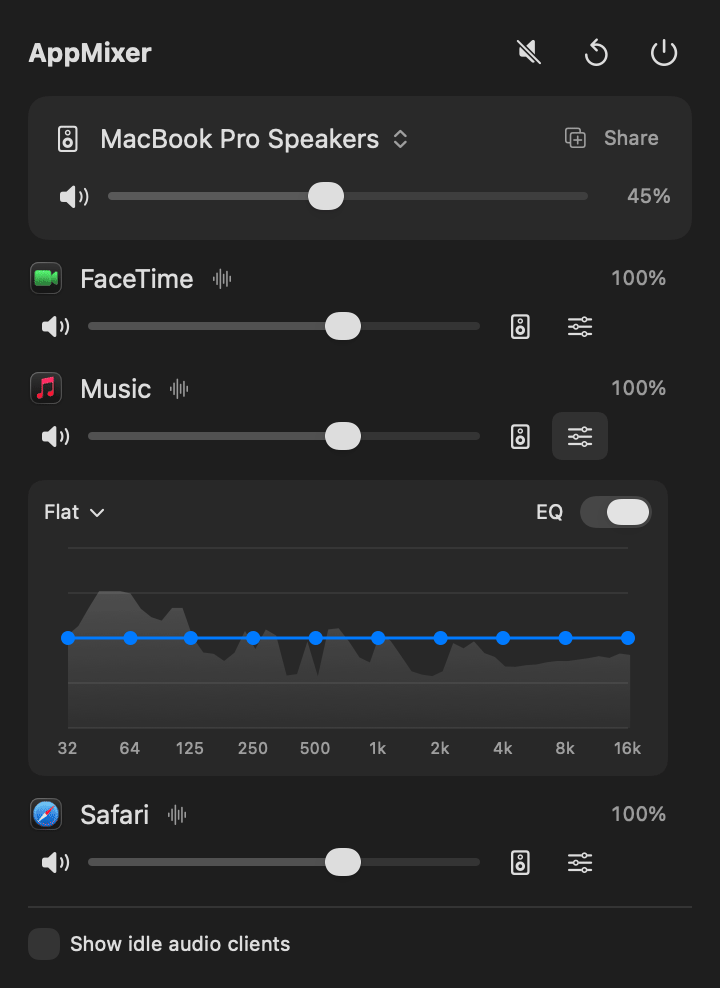

# AppMixer

**Per-app volume, EQ and output device for macOS, from the menu bar.**
Lightweight, native, no audio driver to install.

[简体中文](README.zh-CN.md)

<p align="center">
  
</p>

## Features

- **Per-app volume**: 0–150 % for every app that plays audio, plus mute.
- **Per-app 10-band EQ** (32 Hz–16 kHz, ±12 dB) with presets. Drag the curve directly. The app's **live spectrum** is drawn behind it, so you can see where the bass or the voice sits and how your change affects it.
- **Per-app output device**: for example, Zoom on your headphones while music stays on the speakers.
- **System output**: switch the output device, change system volume, mute.
- **Share Audio**: play the system output on several devices at once (two pairs of headphones, speakers + headphones). The volume slider controls all of them.
- **One click**: mute all playing apps, reset everything, quit. Right-click the menu bar icon for the same actions.
- Settings are remembered per app and applied again when the app restarts.

## Why it's lightweight

- Built on Core Audio **process taps** (public API, macOS 14.2+). There is no virtual audio driver and nothing to install.
- **Apps you haven't touched are not processed at all.** AppMixer only takes over an app when its volume isn't 100 %, its EQ is on, or it plays on another device.
- The audio path does no allocation and no locking. EQ, volume and spectrum together cost about **0.3 % of one CPU core per processed app**.
- The UI is event-driven. It does no polling while the panel is closed, keeps work off the main thread, and redraws only what changed.

## Requirements

- macOS 14.2 or later. Developed and tested on macOS 26 on Apple Silicon.
- To build: the Xcode Command Line Tools (`xcode-select --install`). Full Xcode is not needed.

## Install

```bash
git clone <this repository>
cd AppMixer
./build.sh install      # builds, copies to ~/Applications and launches it
```

A slider icon appears in the menu bar. `./build.sh` only builds `build/AppMixer.app`, and `./build.sh run` launches it from there.

The first time an app needs processing, macOS asks for **System Audio Recording** permission. AppMixer needs it to read an app's audio so it can change it. Audio is processed locally and is never recorded or sent anywhere. If you denied the prompt, enable AppMixer in *System Settings → Privacy & Security → Screen & System Audio Recording → System Audio Recording Only*.

> **Signing.** The build is ad-hoc signed, so rebuilding asks for the permission again. To keep it across builds, create a self-signed code-signing certificate in *Keychain Access → Certificate Assistant → Create a Certificate* (for example "AppMixer Dev") and build with `SIGN_ID="AppMixer Dev" ./build.sh install`.
>
> There is no notarized download yet. If you share a build you made yourself, the recipient has to allow it in *Privacy & Security* (or run `xattr -dr com.apple.quarantine AppMixer.app`).

## Usage

| Where | What |
|---|---|
| Menu bar icon, left click | Opens the mixer. |
| Menu bar icon, right click | Mute all playing apps, reset all, quit. |
| Header | Mute all (click again to unmute), reset all apps (volume, EQ, output), quit (⌘Q). |
| Output card | Click the device name to change the system output. **Share** adds devices that play the system output too. The slider is the system volume. |
| App row | Mute, volume, **output device** (an app routed elsewhere shows "↪ device" next to its name), **EQ** (opens the curve editor with the live spectrum below the row), reset. |
| "Show idle audio clients" | Also lists apps that use audio but are silent right now. Real apps are listed first, background processes after. |

The menu bar icon can be tuned without rebuilding (restart AppMixer afterwards):

```bash
defaults write dev.appmixer.AppMixer iconPointSize -float 17
defaults write dev.appmixer.AppMixer iconOffsetY -float -0.5   # points; positive = down
defaults write dev.appmixer.AppMixer iconWeight semibold       # regular | medium | semibold | bold | heavy
```

## How it works

```
app audio ──▶ process tap (the app is muted at the hardware while AppMixer reads it)
                  │
                  ▼
   private aggregate device [ tap as input + output device(s) ]
                  │  IOProc: EQ (10 biquads) → spectrum ring → volume → limiter
                  ▼
   system output · a chosen device · several devices (stacked aggregate)
```

- **App detection**: AppMixer reads Core Audio's process list. Browsers and others play audio from helper or XPC processes; those are grouped under the app that owns them. Core Audio doesn't send notifications when another process starts or stops output, but it does notify `IsRunning` and `Devices`, so AppMixer listens to those.
- **Following the system output**: some apps (Zoom during a call, for example) keep playing on the old device when the system output changes. AppMixer notices this and moves them to the new output. Apps that deliberately play on another device are left alone.
- **Bluetooth headphones**: coreaudiod makes AirPods and similar headphones the default output as soon as any audio plays on them. While an app is routed there, AppMixer undoes that automatic switch, so the rest of the system stays where it was.
- **Share Audio** creates a public multi-output device, *AppMixer Shared Output*, and makes it the system output. It is removed when you stop sharing or quit. After a crash, it is adopted or cleaned up on the next launch.
- Everything AppMixer creates for processing is private to its process. If AppMixer quits or crashes, every app plays normally again.

## Limitations

- An app that AppMixer processes gets a few milliseconds of extra output latency.
- Switching an app between processed and untouched (for example, leaving 100 %) can cause one short glitch.
- macOS can't change the volume of HDMI/DisplayPort displays, so the system volume slider is disabled for them.
- AppMixer calls two private functions through `dlsym`, and falls back gracefully if either is missing:
  - `TCCAccessPreflight/Request`, to check the permission before muting anything;
  - `responsibility_get_pid_responsible_for_pid`, to group helper processes under their app.

  Because of these, AppMixer can't be distributed through the Mac App Store.

## Development

AppMixer is a Swift package with no Xcode project. All diagnostic flags are side-effect free: they don't change volumes or settings.

```bash
APP=build/AppMixer.app/Contents/MacOS/AppMixer
$APP --selftest            # DSP checks: gain, EQ vs. analytic response, spectrum calibration, timing
$APP --list                # audio processes, grouping, output devices, per-app routing
$APP --watch 15            # live playing-state detection vs. direct reads
$APP --snapshot out.png [--idle] [--demo]   # render the panel to PNG
$APP --measure-open        # main-thread stalls while opening the panel
$APP --icon-preview        # show the menu bar icon for 3 s
./scripts/make-demo-gif.sh # regenerate docs/demo.gif from the real UI with demo data (needs ffmpeg)
```

| File | What it contains |
|---|---|
| `ProcessTap.swift` | Tap, private aggregate device, real-time render path |
| `TapEngine.swift` | Creates and removes taps off the main thread |
| `Equalizer.swift` | Biquad design and EQ processor |
| `Spectrum.swift` | Lock-free ring and FFT analyser |
| `AudioProcessScanner.swift` | App detection and grouping |
| `OutputDevices.swift` | Devices, system volume, Share Audio |
| `MixerModel.swift` | State and routing rules |
| `MixerPanel.swift` | UI |

## License

AppMixer is licensed under [CC BY-NC-SA 4.0](LICENSE).

- **Personal and other non-commercial use is free.** You can use, modify and fork it.
- **Forks and modified versions** must credit the original project and use the same license.
- **Commercial use requires a separate license.** This includes selling AppMixer or a modified version, bundling it with a paid product or service, and using it inside a business for commercial advantage. Please contact the author.

Because commercial use is restricted, AppMixer is source-available rather than "open source" in the OSI sense.
