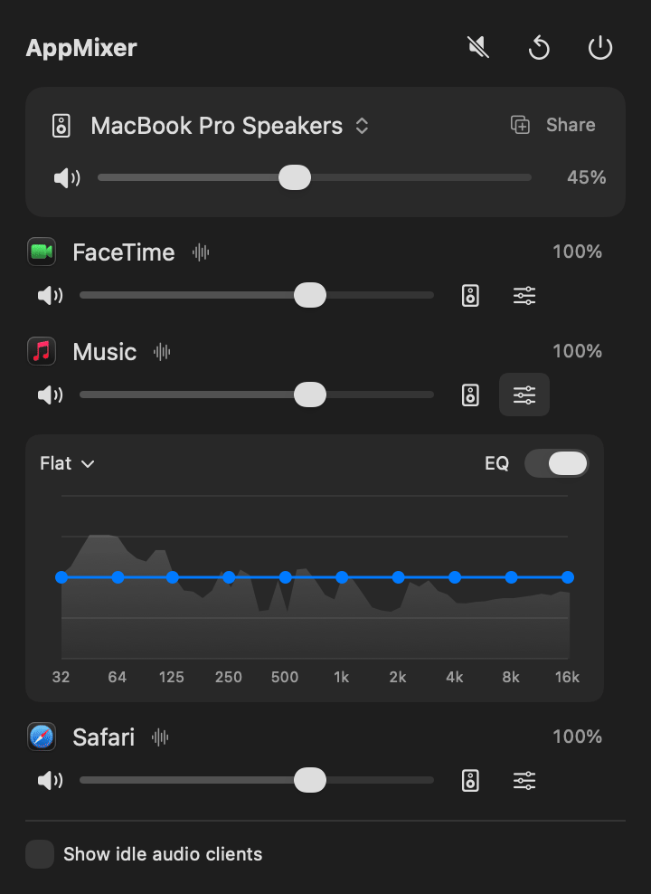

# AppMixer

**macOS 菜单栏工具：按 App 调节音量、EQ 和输出设备。**
轻量、原生，不需要安装音频驱动。

[English](README.md)

<p align="center">
  
</p>

## 功能

- **按 App 调音量**：凡是在播放声音的 App 都可以调，0–150%，可以单独静音。
- **按 App 的 10 段 EQ**：32 Hz–16 kHz，±12 dB，带预设，直接拖动曲线即可调整。曲线背后会显示这个 App 的**实时频谱**，能看到贝斯、人声在哪个频段，也能看到调整后的变化。
- **按 App 指定输出设备**：比如 Zoom 走耳机，音乐继续走音箱。
- **系统输出**：切换输出设备、调系统音量、静音。
- **Share Audio**：系统输出同时播放到多个设备，比如两副耳机，或音箱加耳机。音量滑块会同时调节所有设备。
- **一键操作**：全部静音、全部重置、退出。右键菜单栏图标也能找到这几个操作。
- 设置按 App 保存，App 重启后自动生效。

## 为什么轻量

- 基于 Core Audio **process tap**（公开 API，macOS 14.2+），不需要虚拟声卡，也不用安装任何东西。
- **没调过的 App 完全不处理。** 只有音量不是 100%、开了 EQ 或指定了输出设备的 App 才会被接管。
- 音频处理路径不分配内存、不加锁。EQ、音量和频谱加在一起，每个被接管的 App 约占**单核 0.3%**。
- 界面由事件驱动：面板关闭时不轮询，耗时操作不在主线程上做，只重绘有变化的部分。

## 系统要求

- macOS 14.2 及以上。开发和测试环境是 macOS 26、Apple Silicon。
- 编译需要 Command Line Tools（`xcode-select --install`），不需要完整的 Xcode。

## 安装

```bash
git clone <本仓库地址>
cd AppMixer
./build.sh install      # 编译，复制到 ~/Applications 并启动
```

启动后菜单栏会出现一个滑块图标。`./build.sh` 只编译出 `build/AppMixer.app`，`./build.sh run` 直接从 `build/` 启动。

第一次需要处理某个 App 时，macOS 会请求 **系统音频录制** 权限。AppMixer 需要读取 App 的音频才能调整它。音频只在本机处理，不会被录制，也不会上传。如果点了拒绝，可以到 *系统设置 → 隐私与安全性 → 录屏与系统录音 →「仅系统录音」* 里打开 AppMixer。

> **签名**：编译出来的是 ad-hoc 签名，每次重新编译后都需要重新授权。想避免的话，可以在 *钥匙串访问 → 证书助理 → 创建证书* 里建一个「代码签名」类型的自签名证书（比如叫 `AppMixer Dev`），然后用 `SIGN_ID="AppMixer Dev" ./build.sh install` 编译。
>
> 目前没有公证过的安装包。如果你把自己编译的版本发给别人，对方需要在 *隐私与安全性* 里点「仍要打开」，或者执行 `xattr -dr com.apple.quarantine AppMixer.app`。

## 使用

| 位置 | 作用 |
|---|---|
| 菜单栏图标，左键 | 打开面板 |
| 菜单栏图标，右键 | 全部静音、全部重置、退出 |
| 顶部按钮 | 全部静音（再点一次取消）、全部重置（音量、EQ、输出设备）、退出（⌘Q） |
| Output 卡片 | 点设备名切换系统输出；**Share** 用来添加同时播放系统输出的设备；滑块是系统音量 |
| 每个 App 一行 | 静音、音量、**输出设备**（指定到其他设备的 App，名字旁会显示「↪ 设备名」）、**EQ**（在这一行下方展开曲线编辑器和实时频谱）、重置 |
| Show idle audio clients | 同时列出用过音频、但当前没在出声的 App。真正的 App 排前面，后台进程排后面 |

菜单栏图标可以不重新编译直接调整，改完重启 AppMixer 生效：

```bash
defaults write dev.appmixer.AppMixer iconPointSize -float 17
defaults write dev.appmixer.AppMixer iconOffsetY -float -0.5   # 单位 pt：正数往下，负数往上
defaults write dev.appmixer.AppMixer iconWeight semibold       # regular / medium / semibold / bold / heavy
```

## 工作原理

```
App 的音频 ──▶ process tap（AppMixer 读取期间，原声在硬件层被静音）
                  │
                  ▼
     私有 aggregate device [ tap 作为输入 + 输出设备 ]
                  │  IOProc：EQ（10 个 biquad）→ 频谱缓冲 → 音量 → 限幅
                  ▼
     系统输出 / 指定设备 / 多个设备（stacked aggregate）
```

- **识别 App**：读取 Core Audio 的进程列表。浏览器等 App 的声音来自 helper 或 XPC 进程，这些进程会归到它们所属的 App 下。Core Audio 不会通知其他进程开始或停止输出，但会通知 `IsRunning` 和 `Devices` 的变化，所以 AppMixer 监听的是这两个属性。
- **跟随系统输出**：有些 App（比如通话中的 Zoom）在系统输出切换后仍然留在旧设备上。AppMixer 发现后，会把它转到新的系统输出。主动输出到其他设备的 App 不受影响。
- **蓝牙耳机**：只要有音频开始在 AirPods 这类耳机上播放，coreaudiod 就会把它设为默认输出。当有 App 被指定到这副耳机时，AppMixer 会撤销这种自动切换，系统其他部分保持原样。
- **Share Audio** 会创建一个公开的多输出设备「AppMixer Shared Output」，并设为系统输出。停止共享或退出 AppMixer 时会删除它；如果 AppMixer 崩溃，下次启动时会自动接管或清理它。
- AppMixer 为处理音频创建的东西都只属于它自己的进程。AppMixer 退出或崩溃后，所有 App 都会恢复正常播放。

## 已知限制

- 被处理的 App 会多出几毫秒的输出延迟。
- App 在「被处理」和「不处理」之间切换时（比如音量回到 100%），可能出现一次短暂的爆音。
- macOS 不能调节 HDMI/DisplayPort 显示器的音量，这类设备上系统音量滑块会被禁用。
- AppMixer 通过 `dlsym` 调用了两个私有函数，找不到时会自动降级：
  - `TCCAccessPreflight/Request`：在静音任何 App 之前先检查权限；
  - `responsibility_get_pid_responsible_for_pid`：把 helper 进程归到所属的 App 下。

  因为用到了它们，AppMixer 不能上架 Mac App Store。

## 开发

AppMixer 是一个 Swift package，没有 Xcode 工程。下面这些诊断参数都不会改变任何音量或设置：

```bash
APP=build/AppMixer.app/Contents/MacOS/AppMixer
$APP --selftest            # DSP 自测：增益、EQ 与理论频响的对比、频谱校准、耗时
$APP --list                # 音频进程、分组结果、输出设备、每个 App 的输出去向
$APP --watch 15            # 实时检测到的播放状态，与直接读取的结果对比
$APP --snapshot out.png [--idle] [--demo]   # 把面板渲染成 PNG
$APP --measure-open        # 测量打开面板时主线程的卡顿
$APP --icon-preview        # 在菜单栏临时显示图标 3 秒
./scripts/make-demo-gif.sh # 用演示数据和真实界面重新生成 docs/demo.gif（需要 ffmpeg）
```

| 文件 | 内容 |
|---|---|
| `ProcessTap.swift` | tap、私有 aggregate device、实时渲染路径 |
| `TapEngine.swift` | 在主线程之外创建和删除 tap |
| `Equalizer.swift` | biquad 设计与 EQ 处理 |
| `Spectrum.swift` | 无锁环形缓冲区与 FFT 频谱分析 |
| `AudioProcessScanner.swift` | 识别 App 并分组 |
| `OutputDevices.swift` | 设备、系统音量、Share Audio |
| `MixerModel.swift` | 状态与路由规则 |
| `MixerPanel.swift` | 界面 |
